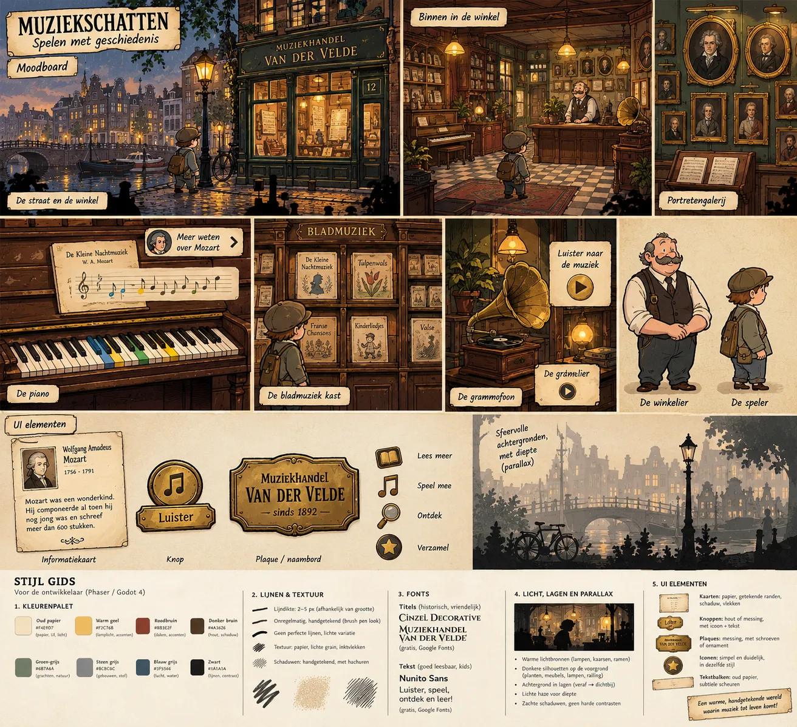
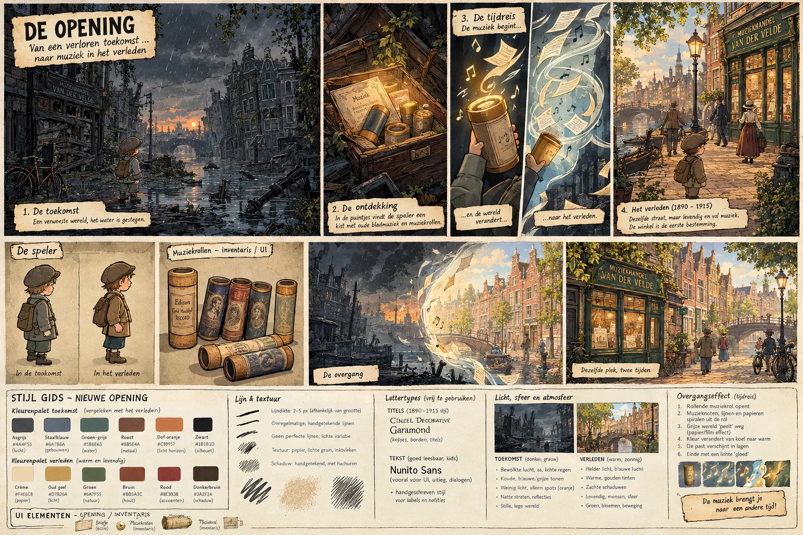

# Design guide

Art direction for the game, taken from the two Gemini mood boards in this folder. Use this as the reference when drawing art, prompting for art, or building UI in code.

| Board | What it covers |
|---|---|
| [`moodboard-winkel.webp`](moodboard-winkel.webp) | The past (1890–1915): canal street, shop interior, piano, sheet music cabinet, gramophone, portrait gallery, clerk, player, UI elements |
| [`moodboard-opening.webp`](moodboard-opening.webp) | The opening: flooded future, the box of cylinders, the time-travel transition, arriving in the past |




## Story flow

1. **De toekomst**: the player starts in a ruined, flooded future version of a Dutch canal street. Dark, silent, no music, but never gory or scary (audience is 5–15).
2. **De ontdekking**: in the rubble they find a glowing wooden box with old sheet music and phonograph cylinders in cardboard tubes.
3. **De tijdreis**: opening a cylinder tube starts the music and pulls the player into the past.
4. **Het verleden (1890–1915)**: the same street, alive and sunny. The player walks to *Muziekhandel Simone* and enters.
5. **In de winkel**: piano (hear, see and play along with the notes), sheet music cabinet, portrait gallery, gramophone, and the clerk with the moustache. Every view links to the others (piece → composer → their other pieces → related composers).

All in-game text is Dutch.

## Art style

Hand-drawn European comic style, inspired by *Valiant Hearts: The Great War* but warm and kid-friendly.

What the final art actually uses (chosen after the first rounds of generated images):

- **Streets (past and future): painterly, semi-realistic.** The past and future street share the same layout (same bridge, tower, quay and shop position) so kids recognise it as one place in two times.
- **Shop interior, objects and characters: the comic ink style** described below.
- **Close-ups** (piano, cabinet, gallery wall) are a little more painted than the shop; the gramophone corner is in the comic style.
- **Team portraits** on the gallery wall (easter egg) are realistic oil paintings, since they hang in the game as paintings.

- **Lines**: 2–5 px depending on object size; irregular, brush-pen look; no perfectly straight lines.
- **Fill**: flat colour with hand-drawn shading and cross-hatching for shadows.
- **Texture**: paper grain and small ink spots over everything.
- **Scenes**: side view, built as a stage in layers (far → near), with dark silhouettes in the foreground (plants, furniture, lamps, railings) framing the action.
- **Light**: warm light sources (lamps, candles, windows), light haze for depth, soft shadows, no harsh contrast.
- **Characters**: chunky, rounded, readable shapes; drawn as cut-out puppets (separate head, arms, legs) so they can be animated with tweens.
- **Player**: kid with a flat cap and backpack. Grey jacket in the future, brown jacket in the past; the cap and backpack stay the same so they're recognisable in both.

## Colour palettes

Hex codes as labelled on the boards.

### Past / shop (warm)

| Name | Hex | Used for |
|---|---|---|
| Oud papier | `#F4E9D7` | paper, UI, light |
| Warm geel | `#F2C76B` | lamplight, accents |
| Roodbruin | `#8B3E2F` | roofs, accents |
| Donker bruin | `#4A3626` | wood, shadow |
| Groen-grijs | `#6B7A6A` | canals, nature |
| Steen grijs | `#8C8C8C` | buildings, dust |
| Blauw grijs | `#3F5566` | sky, water |
| Zwart | `#1A1A1A` | lines, contrast |

The opening board adds a past set for the street scenes: Crème `#F4E6C8` (paper), Oud geel `#D7B26A` (light), Groen `#6A7F55` (nature), Bruin `#8B5A3C` (wood), Rood `#8E3B3B` (accents), Donkerbruin `#3A2F24` (shadow).

### Future (cold)

| Name | Hex | Used for |
|---|---|---|
| Asgrijs | `#4A4F55` | sky |
| Staalblauw | `#6A7B8A` | buildings |
| Groen-grijs | `#5B6E63` | water |
| Roest | `#8B5E4A` | metal |
| Dof oranje | `#C37747` | glow on the horizon, the only warm spots |
| Zwart | `#1B1B1D` | silhouettes |

Rule: in the future, warm colour only appears on things that matter (the box, the cylinders, the horizon). That's how the player knows where to look.

## Atmosphere: future vs past

| Toekomst | Verleden |
|---|---|
| Overcast sky, ash, light rain | Bright light, blue sky |
| Cold blue/grey tones | Warm golden tones |
| Little light, only orange spots | Soft shadows |
| Wet streets, reflections | Lively: people, movement |
| Silent, empty world | Green, flowers, music |

## Time-travel transition

1. The cylinder tube opens.
2. Music notes, lines and paper spirals swirl out of it.
3. The grey world peels away like paper or film.
4. Colour shifts from cold to warm.
5. The past builds up in layers (back to front).
6. Ends with a soft glow.

## Fonts (free, Google Fonts)

- **Titles, signs, plaques**: Cinzel Decorative
- **Headings**: EB Garamond
- **Body text, UI, dialogue**: Nunito Sans (very readable for young kids)
- **Labels and notes**: a handwritten style

## UI elements

The UI is part of the world, not modern buttons.

- **Cards**: aged paper, drawn edges, drop shadow, stains (e.g. the composer info card).
- **Buttons**: wood or brass, always icon + text.
- **Plaques**: brass, with screws or ornament (shop sign: *Muziekhandel Simone*).
- **Icons**: simple and clear, same ink style. Core set: *Lees meer* (book), *Speel mee* (note), *Ontdek* (magnifier), *Verzamel* (star).
- **Text bars**: old paper with subtle tears.
- **Inventory**: *Briefje* (note, action), cylinder tubes (collectibles).
- **Piano**: coloured keys light up for the note being played, so kids can follow along.
- Big click targets and short texts: understandable for a 5-year-old (icons), still interesting for a 15-year-old.

## Notes on the boards

- Composers and titles on the boards (Mozart, *Tulpenwals*, …) are placeholders. Real pieces and people come from the Muziekschatten data.
- The board calls the cylinders *muziekrollen*, but in Dutch that usually means a pianola roll. Use **fonograafrollen** (or *wasrollen*) in the game text.
- Watch for typos generated in the boards (e.g. "De gramelier") when copying text.

## Game art

All game-ready images are in [`public/art/`](../../public/art/) as WebP (about 4.5 MB in total). [`public/art/manifest.json`](../../public/art/manifest.json) lists every image with its size, so the game can load them by key (e.g. `shop/piano`).

| Folder | Contents |
|---|---|
| `past-street/`, `future-street/` | Parallax layers, back to front: `sky`, `far`, `walk` (the quay the player walks on, with the shop on the right), `foreground` (dark silhouettes). Layers are full-width and line up with each other. `future-street/crate` is the box with the cylinders. |
| `shop/` | `back-wall`, `foreground`, and the clickable objects `piano`, `counter`, `cabinet`, `gramophone` (piano and cabinet seen straight from the front); `frames/` holds the empty golden picture frames. |
| `closeups/` | Full-screen views: `piano` (empty music stand and keyboard strip, filled by the game), `cabinet` (empty slots), `gallery-wall`, `gramophone-corner`. |
| `characters/` | `kid-past`, `kid-future` (gas mask), `shopkeeper`: each has `full` plus separate puppet parts (`head`, `torso`, arms, legs). Parts ending in `-1` were on the left of the sheet. `sheetX`/`sheetY` in the manifest give each part's position on the original sheet, as a starting point for putting the puppet together. All characters share one scale. The shopkeeper faces the front and has extra heads to swap in while he talks: `head-smile`, `head-talk`, `head-blink`, `head-surprised`. |
| `characters/cyclist-man`, `cyclist-woman` | Street NPCs on bicycles, side view facing right (mirror them to ride left). `full` plus `bicycle` (frame without wheels), `wheel-1`/`wheel-2` and `crank` to spin, the rider's body and legs to pedal. |
| `items/cylinder/` | Phonograph cylinder tubes (`cream`, `red`, `blue`, `green`, `open`). |
| `items/sheet-music/` | `cover-1` to `cover-6`: placeholder covers with an empty title label (the real title is drawn by the game). `cover-inside`, `page-left`, `page-right` (empty staves) for the opening animation: the cover folds open from the left edge and the two pages show side by side, with the notes drawn on the staves by the game. |
| `ui/` | Empty `card`, `plaque`, `button`, `paper-strip`; `icons/` with `read`, `music`, `discover`, `collect`, `play`, `back`, `sound`, `close`. |
| `fx/` | `glow-yellow`, `glow-orange`, `fog`, `rain`, `ash` (light on transparency, works with additive blending), `sheet-music`, `note` (for the time-travel swirl). |
| `portraits/` | `team-1` to `team-4`: the team as oil paintings for the gallery. |

### Adding or replacing art

The source images (with magenta backgrounds) live outside the repo in the `design` folder. [`scripts/import_art.py`](../../scripts/import_art.py) removes the magenta, cuts the sheets into parts, shrinks everything and writes `public/art/`:

```bash
python3 -m venv .venv && .venv/bin/pip install -r scripts/requirements-art.txt
.venv/bin/python scripts/import_art.py ../design
```

To add an image, put it in the design folder, add a line for it in `ASSETS` at the top of the script and run it again. Generate new art with a flat magenta (`#FF00FF`) background, or black for glows and other light effects.
